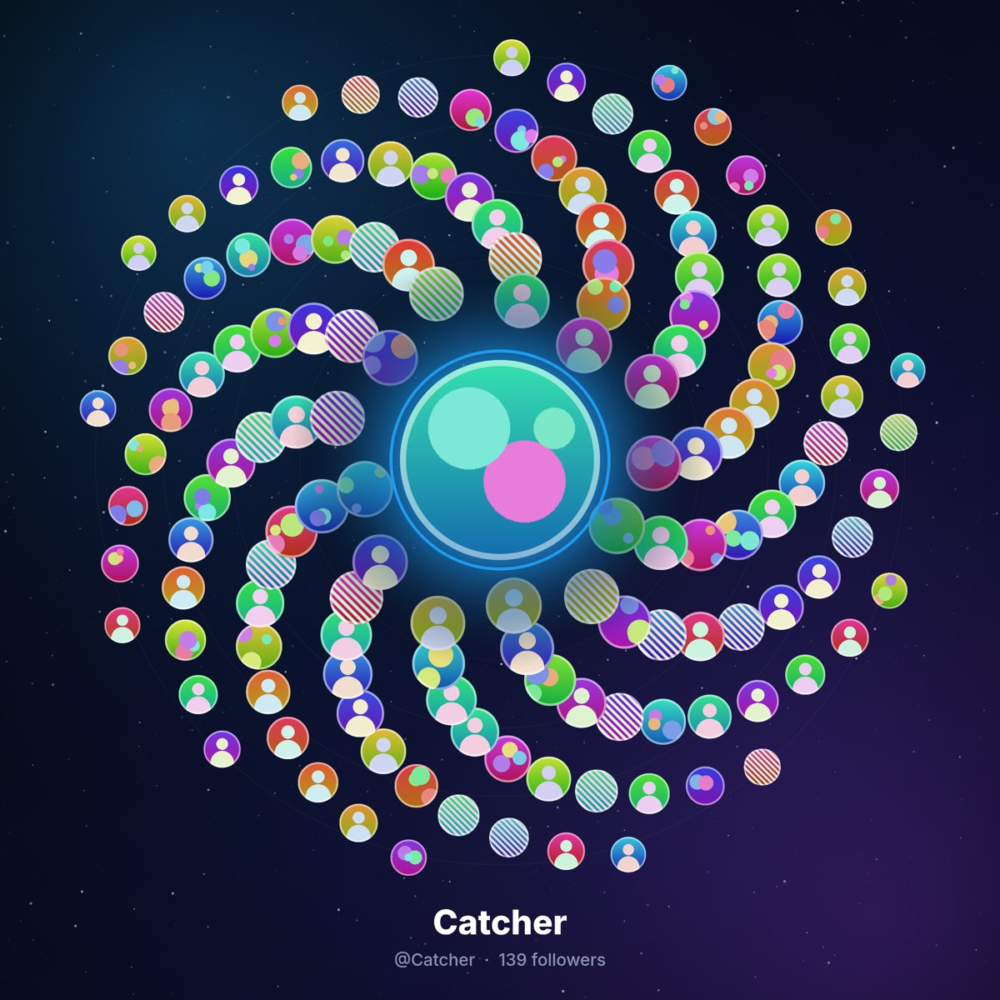

# Follower Mosaic

**English** · [简体中文](README.zh-CN.md)

Turn your X (Twitter) followers' avatars into one beautiful image: your name spelled in avatars, a galaxy, a heart, or a clean grid wall. Free, open source, read-only, and everything runs in your own browser.

| Name | Galaxy | Heart | Grid |
|---|---|---|---|
|  |  |  |  |

<sub>Previews use synthetic, generated avatars.</sub>

Made by **[@Kuno_he](https://x.com/Kuno_he)** · MIT License · Not affiliated with X Corp.

## Install

- **Chrome Web Store**: *coming soon* — `https://chromewebstore.google.com/detail/<id>` (placeholder)
- **Load unpacked** (now):
  1. Download `follower-mosaic-extension.zip` from [Releases](https://github.com/hezongkun/follower-mosaic/releases) (or build it, see below) and unzip it.
  2. Open `chrome://extensions`, turn on **Developer mode** (top right).
  3. Click **Load unpacked** and choose the unzipped folder.

## Usage

1. Open [x.com](https://x.com) and log in as usual.
2. Click the Follower Mosaic icon. Your account is detected automatically; the style cards preview your own name.
3. Optional: type another username, choose the **reading speed** (1–10 s per page, default 5) and **max followers** (100–5000, default 500).
4. Press **✨ Make my follower mosaic**. A panel opens inside the same x.com tab and shows progress.
5. When it's done: edit the text ("What should it spell?"), switch font / style / colors without re-fetching, then **⬇️ Download image** (2400 px PNG). Closing the panel takes you back to the page you were on.

The UI is bilingual (English / 中文): it follows your browser language, and the **中/EN** button switches and remembers it. Captions on the image follow too ("139 followers" / "139 位粉丝").

X's follower count also includes suspended, hidden or deactivated accounts, so the readable list is usually a little shorter. The panel then says "Read all visible followers (N)".

## Privacy & account safety

- **No authorization**: no password, no API token, no OAuth. It works inside *your own* logged-in x.com tab with the session you already have.
- **Read-only**: only HTTP `GET` requests for the follower list and profile. It never posts, follows, likes or sends messages.
- **Gentle**: one page at a time with a pause (default 5 s plus random jitter), a follower limit, and automatic waiting on HTTP 429 using `x-rate-limit-reset`.
- **Follows X's own requests**: the extension opens the Followers list in-app and reuses the exact request X itself made (query id, parameters, headers), changing only the cursor. No guessed endpoints.
- **Local only**: no server, analytics or uploads. The image is drawn on your computer. Only small preferences (language, font, text, speed, limit) are stored in `chrome.storage.local`.
- **Minimal permissions**: `activeTab`, `scripting`, `storage`. No host permissions; nothing runs until you click.
- Privacy policy: <https://hezongkun.github.io/follower-mosaic/privacy.html>

Automated access may be subject to X's Terms of Service; use it moderately.

## Other ways to use it

- **Web generator**: [`web/index.html`](web/index.html) is a single offline page. Load a `followers.json` and render with all styles (including the X-logo style), themes and up to 4800 px.
- **Console script / bookmarklet**: [`fetch/fetch-followers.js`](fetch/fetch-followers.js) (paste into the DevTools console on x.com) or [`fetch/bookmarklet.html`](fetch/bookmarklet.html). It downloads `followers-<name>.json`. Settings are in `CONFIG` at the top (`MAX_USERS` default 500, `DELAY_MS` 5000, `LANG`, …).
- **CLI**: `node cli/render.mjs --data followers.json --style galaxy --lang en --out galaxy.png`. It uses your local Chrome; zero npm dependencies (Node ≥ 22).

## Build

```bash
node web/build.mjs                       # embed i18n + fonts into web/index.html
node fetch/build-bookmarklet.mjs         # rebuild the bookmarklet
node extension/build.mjs                 # regenerate extension/lib from shared sources
node extension/build-store.mjs --zip follower-mosaic-extension.zip   # Chrome Web Store build
node extension/test-extension.mjs /tmp/shots    # popup test (headless Chrome)
node extension/test-overlay.mjs /tmp/shots      # in-page overlay test against a mock x.com
python3 tools/i18n-check.py              # no hard-coded UI strings outside the dictionary
```

The store build removes the X-logo style and the demo/screenshot mode. Store listing material is in [`store/`](store/); the GitHub Pages site (privacy policy) is in [`docs/`](docs/).

## Repo layout

```
extension/  MV3 extension: popup, lib/overlay.js (in-page panel, Shadow DOM),
            lib/capture-main.js (reuses X's own Followers request), content.js (fallback)
web/        index.html generator · i18n.js (shared zh/en dictionary) · fonts (OFL)
fetch/      console script + bookmarklet
cli/        headless renderer
store/      Chrome Web Store listing, privacy practices, assets
docs/       GitHub Pages: index.html, privacy.html
examples/   screenshots and previews
```

## License

MIT © 2026 [Kuno_he](https://x.com/Kuno_he). The bundled fonts Fredoka and Pacifico are under the SIL Open Font License (see `web/fonts/`).
