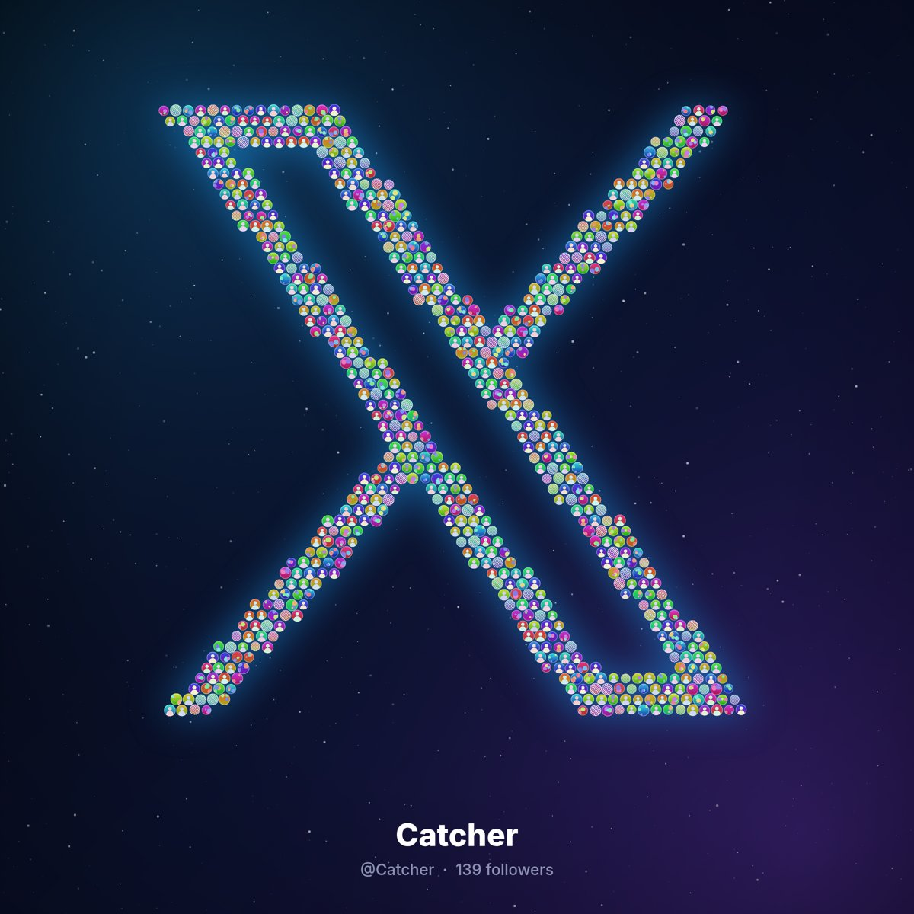
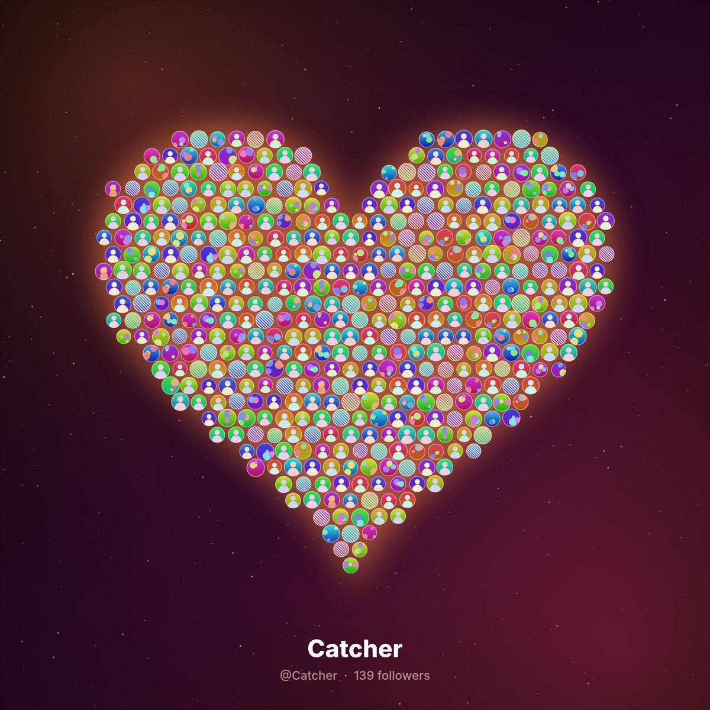
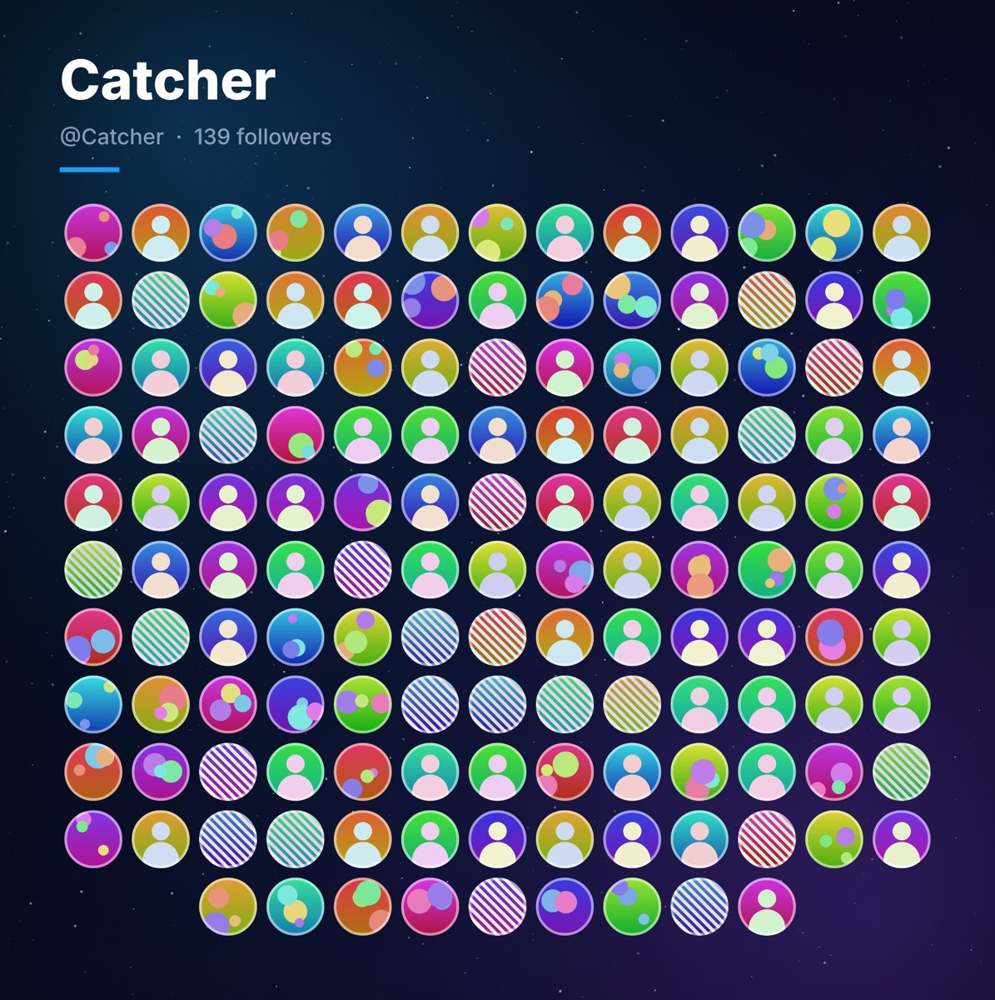

# 粉丝拼图 Follower Mosaic

[English](README.md) · **简体中文**

把你的 X（Twitter）粉丝头像拼成一张好看的图：用头像拼出你的昵称、X 标志、爱心，或者整齐的头像墙。免费开源，只读取，全部在你自己的浏览器里完成。

| 昵称 | X 标志 | 爱心 | 头像墙 |
|---|---|---|---|
|  |  |  |  |

<sub>示例图使用的是程序生成的虚拟头像。</sub>

作者 **[@Kuno_he](https://x.com/Kuno_he)** · MIT 协议 · 与 X Corp. 无关联

## 安装

- **Chrome 应用商店**：*即将上架*，链接 `https://chromewebstore.google.com/detail/<id>`（占位）
- **手动安装（现在就能用）**：
  1. 从 [Releases](https://github.com/hezongkun/follower-mosaic/releases) 下载 `follower-mosaic-extension.zip`（或按下方命令自己构建），然后解压。
  2. Chrome 地址栏打开 `chrome://extensions`，打开右上角的「开发者模式」。
  3. 点「加载已解压的扩展程序」，选择解压出来的文件夹。

## 使用

1. 打开 [x.com](https://x.com)，像平时一样登录。
2. 点浏览器右上角的「粉丝拼图」图标。插件会自动识别你的账号，样式卡片直接用你的昵称预览。
3. 可选：输入别人的用户名；选择**读取速度**（每页 1–10 秒，默认 5 秒）和**最多读取**人数（100–5000，默认 500）。
4. 点「✨ 生成我的粉丝头像图」。当前 x.com 页面里会弹出一个面板，显示读取进度。
5. 读完后可以：改「拼成什么字？」，换字体、样式、配色（都不用重新读取），然后点「⬇️ 下载图片」（2400 像素 PNG）。关闭面板会回到你原来的页面。

界面支持中文和英文，默认跟随浏览器语言，右上角 **中/EN** 按钮可以切换并记住选择；图片上的说明文字也会跟着变（「139 位粉丝」/「139 followers」）。

X 显示的粉丝数还包含已封禁、受保护隐藏或已停用的账号，所以能读到的通常会少几个，面板会显示「已读完全部可见粉丝（N 位）」。

## 隐私与账号安全

- **不需要授权**：不要密码、不要 API Token、不走 OAuth。插件只在你自己已登录的 x.com 页面里，用你现有的登录状态运行。
- **只读**：只发送读取粉丝列表和资料的 HTTP `GET` 请求，绝不发帖、关注、点赞或私信。
- **温和**：一页一页地读，每页之间暂停（默认 5 秒并加随机抖动），有人数上限；遇到 429 限流会按 `x-rate-limit-reset` 自动等待。
- **照着 X 自己的请求来**：插件在页面内打开粉丝列表，复用 X 自己发出的那个请求（queryId、参数、请求头），只改翻页游标，不靠猜接口。
- **数据留在本地**：没有服务器、没有统计、不上传任何东西。图片在你的电脑上生成。`chrome.storage.local` 只保存语言、字体、文字、速度、上限这些小设置。
- **最少权限**：`activeTab`、`scripting`、`storage`，只访问 x.com / twitter.com。一个小脚本在页面内存里记下 X 自己加载的粉丝请求（这样已经打开的粉丝页也不会漏掉），不发送任何数据，你点「生成」之前不做任何事。
- **诊断信息**：出问题时面板会显示每一步和已用时间，「复制诊断信息」会复制一份去掉了 cookie/token 的 JSON 日志，可以贴到 issue 里。
- 隐私政策：<https://hezongkun.github.io/follower-mosaic/privacy.html>

自动化访问可能受 X 服务条款约束，请适度使用。

## 其他用法

- **网页生成器**：[`web/index.html`](web/index.html) 是一个可离线使用的单文件网页。加载 `followers.json` 即可生成，支持全部样式（另有星系样式）、配色，最大 4800 像素。
- **控制台脚本 / 书签**：[`fetch/fetch-followers.js`](fetch/fetch-followers.js)（在 x.com 的 F12 控制台里粘贴运行）或 [`fetch/bookmarklet.html`](fetch/bookmarklet.html)，会下载 `followers-用户名.json`。设置在脚本顶部的 `CONFIG`（`MAX_USERS` 默认 500，`DELAY_MS` 5000，`LANG` 等）。
- **命令行**：`node cli/render.mjs --data followers.json --style galaxy --lang zh --out galaxy.png`。它会调用你本机的 Chrome，不需要任何 npm 依赖（Node ≥ 22）。

## 构建

```bash
node web/build.mjs                       # 把 i18n 和字体嵌入 web/index.html
node fetch/build-bookmarklet.mjs         # 重新生成书签
node extension/build.mjs                 # 从共享源码重新生成 extension/lib
node extension/build-store.mjs --zip follower-mosaic-extension.zip   # 应用商店版本
node extension/test-extension.mjs /tmp/shots    # 弹窗测试（无头 Chrome）
node extension/test-overlay.mjs /tmp/shots      # 用模拟 x.com 测试页面内面板
python3 tools/i18n-check.py              # 检查代码里没有写死的界面文字
```

应用商店版本只去掉截图用的演示模式。星系样式保留在网页生成器和命令行里。上架材料在 [`store/`](store/)，GitHub Pages 网站（隐私政策）在 [`docs/`](docs/)。

## 许可

MIT © 2026 [Kuno_he](https://x.com/Kuno_he)。内置字体 Fredoka 和 Pacifico 使用 SIL Open Font License（见 `web/fonts/`）。
